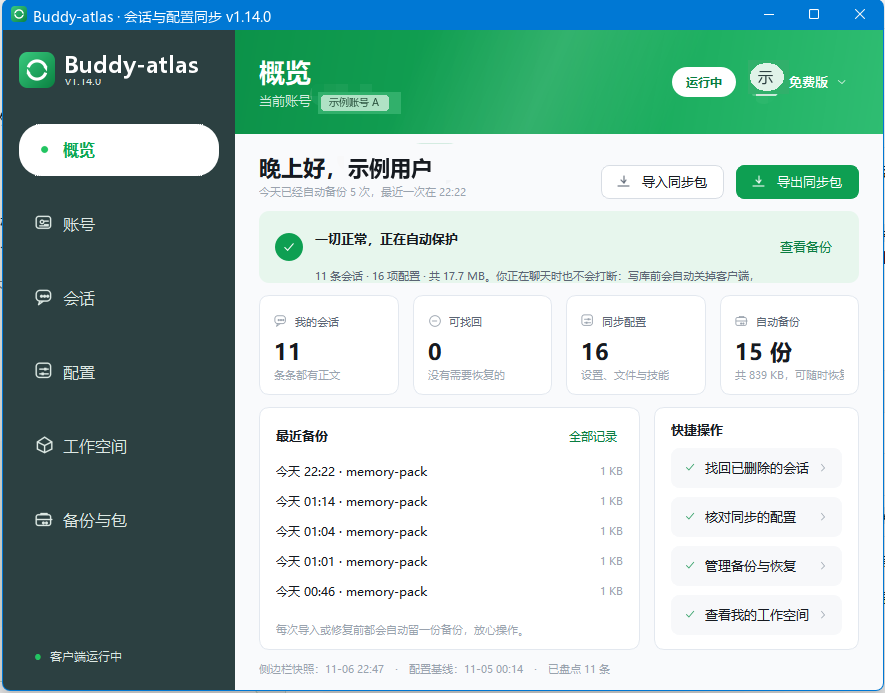
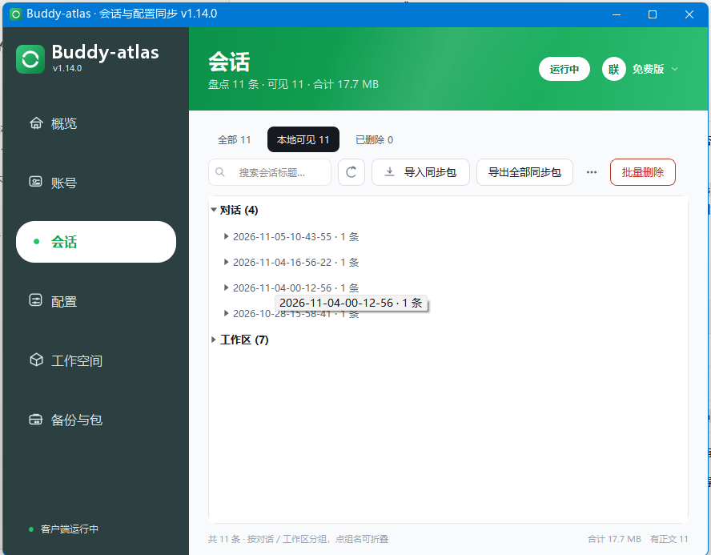
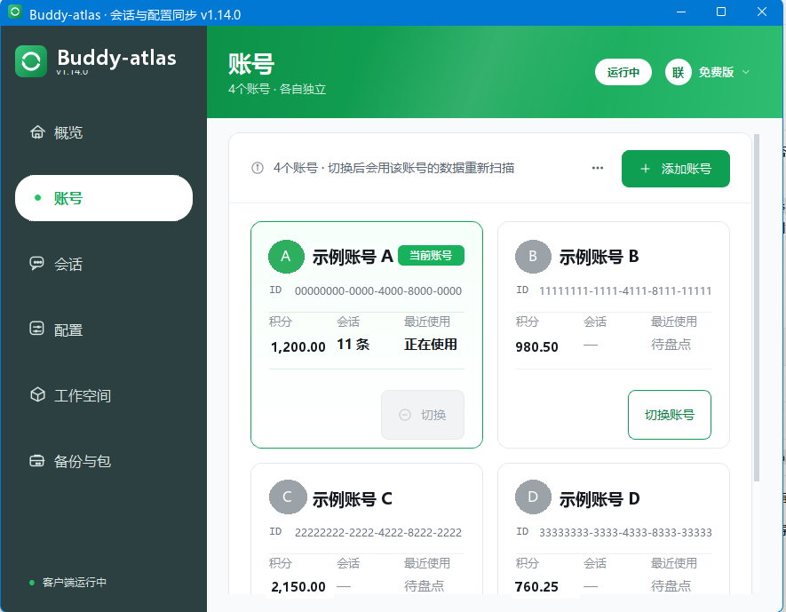
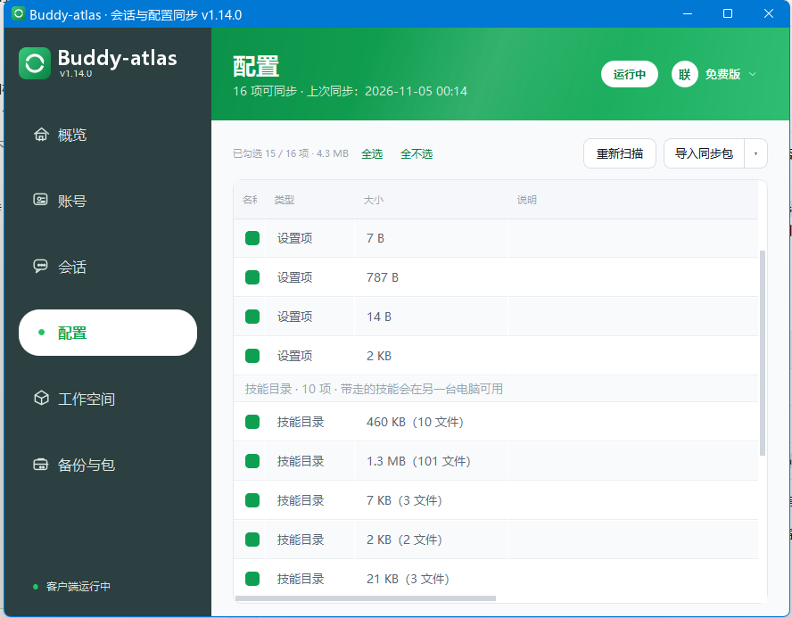
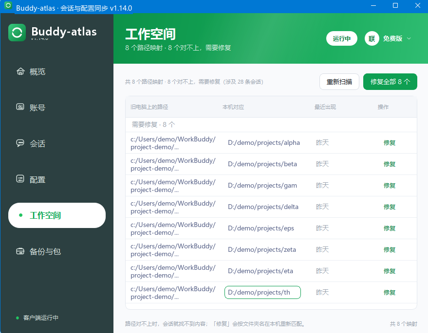
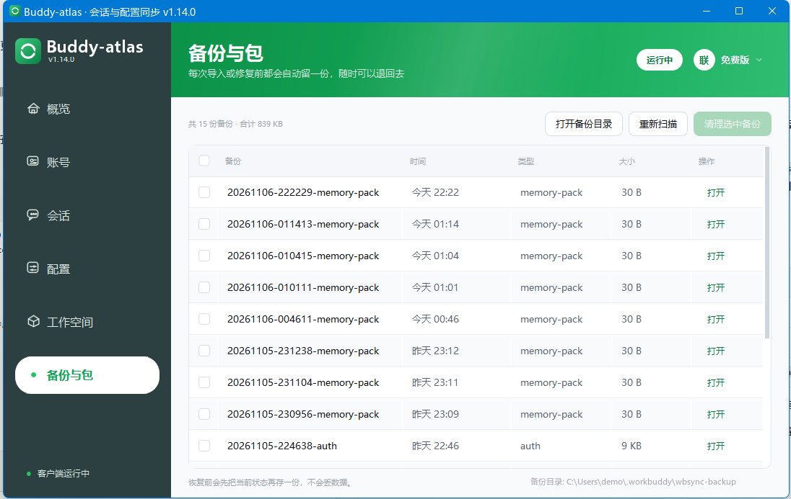

# Buddy-atlas

Windows 上的本地会话与配置管理工具。它读 WorkBuddy 客户端存在本机的会话、设置和工作空间数据，做几件客户端自己没提供的操作：换电脑时搬运数据，找回删掉的会话，在多个账号之间并集对齐，把换机后对不上的工作空间路径改回本机目录。

程序平时只读写本机文件。唯一会联网的动作是你点侧栏的「检查更新」，它向 GitHub 查一次最新 Release；要不要下载由你决定，不自动安装，也不上传任何数据。这工具会改动客户端的数据，用之前先看一眼文末的免责声明。

## 用来做什么

换电脑时，把会话正文、设置项、人格文件、技能包和工作空间记忆打成一个 `.wbsync.zip`，在另一台机器导入。两台机器各自续写过的同一条会话会摆在一起让你选留哪份，被覆盖的那份单独留一份备份。

客户端里删掉的会话，本地记录往往还在。这里可以把删除标记清掉，重启客户端后它回到侧边栏；也可以反过来，把已删除的会话连同正文从本机彻底清干净。

多账号场景下，可以把一个账号的会话复制给另一个账号，或者把客户端的登录身份切到另一个账号。换机后工作空间目录对不上时，按文件夹名在本机重新匹配，批量改掉。

凡是要写会话库的操作都会先自动留一份备份。导入、账号切换、对齐、恢复、路径修复还会关闭客户端，未发送的输入和进行中的对话会中断。动手前先把手头的对话发完。

## 开始之前



- Windows 10 / 11，这台机器装过并登录过 WorkBuddy 客户端。工具读的是客户端留下的本地数据，客户端没登录过时只能看到有限内容。
- 到 [Releases 页面](https://github.com/kelisidina725/Buddy-atlas/releases/latest) 取 `Buddy-atlas-1.14.0.exe`，或者用这个[直接下载链接](https://github.com/kelisidina725/Buddy-atlas/releases/download/v1.14.0/Buddy-atlas-1.14.0.exe)。双击就能运行，不用装 Python。源码运行方式在文末。
- 首次打开落在「概览」。左栏六个页签：概览、账号、会话、配置、工作空间、备份与包。

概览页是这台机器的统计和最近一次备份，导入导出的快捷入口也在这一页。账号页一张卡一个账号，显示昵称、积分快照的最近一次观察值、会话条数和最近使用时间；当前登录的账号有「当前账号」标记，其它账号可以点「切换账号」。点卡片空白处只是查看这个账号的数据，不改登录态，也不写任何东西。卡片右上角的「⋯」里有修改账号名、打开数据目录、本机账号对齐、添加账号。

会话页是主要工作区，上方筛选档、中间列表、右侧详情面板，工具栏有重新盘点、导入同步包、导出全部同步包。配置页按设置项、人格文件、技能包列出可同步的本机配置，可以全选、重新扫描。工作空间页管换机后失效的目录映射。备份与包页放着导入或修复前自动留下的还原点，能打开目录、在资源管理器里查看某一份、勾选清理。

## 检查更新

<!-- 截图：检查更新对话框 -->

侧栏最下面的「检查更新」是程序里唯一会联网的地方。启动、盘点、导入导出都不碰网络，只有点开它才去 GitHub 查一次最新 Release，把当前版本、最新版本和发布说明摆在一起。

有新版时可以点「下载新版」，选个保存位置，边下边显示进度。下载完会拿 Release 上登记的 SHA256 核对一遍，对不上就删掉半成品。想自己挑版本，或者进度条走得实在太慢，点「打开 Release 页面」；下载过程中还有「用浏览器下载」，把附件直链交给浏览器。

下载来的 exe 不会替换正在运行的程序，也不自动重启。关掉 Buddy-atlas 后自己替换文件就行。查不到或连不上 GitHub 不影响其它功能。

## 看懂会话页的分档



页签把会话分成互不重叠的几档，切一档就只看这一类。

| 分档 | 里面是什么 |
|---|---|
| 全部 | 库里的所有会话，含客户端已删除的 |
| 本地可见 | 有正文、客户端侧边栏里看得到的 |
| 已删除 | 客户端里被删掉的，可恢复，也可彻底清除 |
| 缺正文 | 有元数据但找不到正文文件，恢复出来也只是空壳 |
| 未在侧边栏 | 有正文、已注册云端，但客户端左栏不显示 |

「只看未注册云端」不是第六档，是叠在当前档位上的过滤，用来找那些有正文、另一台机器却看不到的会话。「缺正文」和「未在侧边栏」在没有对应条目时会自动收起。页脚会显示已隐藏的条数和当前范围的统计。

点一条会话，右侧详情面板给出三个动作：恢复此会话（清掉删除标记，重启客户端后回到侧边栏）、导出会话包（把这一条单独存成包）、物理清除选中会话（从库和磁盘彻底移除，不可撤销）。

云端会话是个例外。删掉本地那一行，客户端重启后会把它重新下发，所以工具对云端会话不删行，只在本工具里隐藏。页脚会常驻「已隐藏 N 条」，用「⋯ → 显示已隐藏的会话」恢复显示。真要删，请到客户端里删并等云端同步。

## 常见操作

### 换电脑搬数据

<!-- 截图：导出同步包弹窗、四步导入向导 -->

1. 老机器的会话页点「导出全部同步包」。弹窗列出包里有多少条会话、多少项配置、多少个工作空间的记忆文件。范围固定为当前登录账号，跟侧栏此刻选中哪个账号无关，含凭据的配置项固定排除。点「导出全部」，在系统保存框里存成 `.wbsync.zip`。
2. 把包拷到新机器。包不加密，里面是会话正文和个人笔记，别放进公开网盘或共享目录。
3. 新机器的会话页或概览页点「导入同步包」。向导按包里实际有的内容分四步：会话、工作空间映射、配置、记忆，空的步骤跳过。前三步只收集选择，不写盘；可以回看，不能往前跳。
4. 会话这一步按三级树列出内容，对话按日期分组，工作区按空间名分组，逐条勾选。工作空间映射这一步把源路径改成本机目录，留空则不映射，右边「记忆」列是上次在这台机器设过的落点。配置这一步逐项判定，冲突项要自己选跳过、保留本地版本还是采用对端版本。记忆这一步同名文件按更新时间保留较新的那份，覆盖前自动备份。
5. 两台机器各自续写过同一条会话时会算作分叉。判据是正文末行的时间戳，不看标题改动时间。默认保留续写更晚的那份，也可以改成保留本机、保留包内或两份都留；被丢掉的那份会单独备份，路径写在执行完成的提示里。
6. 点「执行导入」前还会再确认一次，写入不可撤销。执行时先自动备份、关闭客户端，完成后可以勾选自动重启 WorkBuddy。注意导入会把会话归属改到本机当前登录账号，如果某条会话原本属于别的账号，那是搬走不是复制，原账号里将不再看到它。想两边都留一份，改用「本机账号对齐」。

### 找回误删的会话，或彻底清掉

<!-- 截图：已删除分档与批量删除多选模式 -->

切到「已删除」档，点一条看右侧详情，点「恢复此会话」。删除标记被清掉，正文原样保留，写入前会备份会话库，重启客户端后它回到侧边栏。「缺正文」的会话本地没有内容，恢复出来只是空壳，得等客户端重新从云端拉回。

要彻底清掉，工具栏的「清除已删除…」会把当前账号下已删除的会话从库里移除。也可以点「批量删除」进入多选模式，勾选后一次删除；按 Esc 或离开会话页会退出多选。确认框里默认不勾「同时备份到备份区」，不勾就删了没法恢复；如果勾选列表里混着还活着的会话，还要输入确认词才能继续。

### 切换登录账号



账号页找到目标卡，点「切换账号」。三步向导依次是目标与来源、迁移内容、确认。只能切到本机存有登录凭据的账号，没在这台机器登录过的账号是灰的；「从其它工具导入凭据…」会只读地查 `~/.buddy-switch/accounts.json`。

迁移内容里可以勾「复制会话到目标账号」，每条生成一个新 id，原账号那份不动；也可以勾「合并长期记忆」，只补目标没有的小节，改写前备份原文。执行时会先备份认证文件和数据库，然后关闭客户端、改写凭据、重启。这一步会打断正在进行的对话，包括你当下在客户端里开着的那个。

### 在多个账号之间对齐会话

<!-- 截图：本机账号对齐向导 -->

账号页「⋯ → 本机账号对齐…」打开四步向导：计划页选写给谁，下一步选会话，第三步确认人格与记忆文件（SOUL、IDENTITY、USER、BOOTSTRAP），最后执行。只能选一个接收账号，多选会让磁盘占用翻倍；当前登录账号只作为数据来源，不会被写入。

会话列表里每条都带判定徽标：已复制过、已有相同内容、可追加 N 行、目标里更新、内容已分叉。勾选要复制或追加的。追加是把缺的行补进目标里那份旧版本，不新增副本，所以同一段对话不会在侧边栏里出现两次。执行前会关闭客户端，耗时主要在正文复制。

### 同步配置



配置页列出本机可同步的设置项、人格文件和技能包，「重新扫描」刷新清单。点「导入同步包」走整包流程；只想搬配置，用按钮箭头里的「导入配置包（仅配置）…」。

导入计划里，两端在上次同步后都改过的项算冲突，要逐项选跳过、保留本地版本或采用对端版本。没选的一律跳过。先点「仅演练（不写入）」看一遍结果，再点「执行同步」。标着「含凭据」的项要谨慎，整包导出时它们本来就被排除在外。

### 修复换机后的工作空间路径



工作空间页会显示「需要修复 · N 个」。左列是包里记的旧路径，右列填本机对应目录，「记忆」列是上次在这台机器设过的落点，可以直接用。逐行点「修复」，或者填好整列后点「修复全部」。

修复会同时把正文目录改名，写库前备份会话库。这一步要求先手动完全退出 WorkBuddy，工具不会替你关；没退出时按钮会拦下来。行尾的「忘记」只删掉本地的映射记录，不动会话数据。

### 备份与回退



每次导入、恢复、修复之前都会自动留一份备份。备份与包页能打开备份目录、重新扫描、在资源管理器里打开某一份，表头的方框是全选。恢复前会先把当前状态再存一份，不会覆盖掉现有数据。

「清理选中备份」是永久删除，弹窗里会列出份数和占用空间。只有在确认当前数据一切正常时才该删。

## 从源码运行

Windows 10 / 11，Python 3.13 或 3.14，PySide6 6.9+。

```bash
python -m venv .venv
.venv\Scripts\activate
pip install -r requirements.txt
python app.py
```

`python app.py --version` 打印版本号。`python app.py --selftest` 检查打包依赖和各模块是否齐全，结果写到 `~/.workbuddy/wbsync-selftest.log`，不改用户数据，也不联网。

打包单文件 exe 用 `pyinstaller wbsync.spec`。`wbsync.spec` 从 `wbsync/__init__.py` 的 `__version__` 取版本号写进 exe 文件属性。想用 UPX 压缩就自己准备官方未修改版，通过 `--upx-dir` 指定，仓库不带第三方二进制文件。

## 数据边界

除了主动点「检查更新」，程序不发起网络请求。检查时读 `https://api.github.com/repos/kelisidina725/Buddy-atlas/releases/latest`，下载时访问附件直链，两次都不会带上本机数据。其余时候只读这些位置：

| 用途 | 位置 |
|---|---|
| 会话正文与元数据 | `~/.workbuddy/projects/**/*.jsonl`、`~/.workbuddy/workbuddy.db` |
| 云端映射 | `~/.workbuddy/edge-sync-mapping-v*.db` |
| 账号信息 | 客户端 auth 信息文件、`~/.buddy-switch/accounts.json`、`credit_usage_snapshots.json` |

账号卡上的积分是外部工具留下的最近一次观察值，不是实时余额，界面会标出观察时间，没有记录就显示「—」。

这些目录是第三方客户端的内部实现，客户端升级可能改格式，本工具不保证兼容未来版本。导出的同步包不加密，会话正文和工作空间记忆都在里面，传输和存放自己负责。

## 免责声明

Buddy-atlas 不是腾讯、WorkBuddy 或 CodeBuddy 的官方产品，也没得到它们的授权或认可。文档里反复提到 WorkBuddy，只是因为工具读的是这个客户端留在本机的文件，不表示任何隶属关系；WorkBuddy、CodeBuddy 这些名称和商标归各自权利人所有。

客户端的本地数据格式没有公开文档，一升级就可能变，工具跟着读错或写坏都说不准。重要会话自己另外留一份，别把这里的还原点当成唯一副本。导入、切换账号、对齐、恢复、物理清除都会改动客户端的数据，操作前会自动备份，但「清理选中备份」能把备份永久删掉。会话没了、客户端打不开，这些得自己收拾，MIT 许可证写明了不提供任何担保。

仓库文档和截图里的账号、积分、路径一律是示例值。

## 许可与版本

源码用 [MIT](LICENSE)，第三方组件许可和分发二进制时要做的事写在 [NOTICE](NOTICE)。首个公开版是 v1.14.0，沿用内部开发序列，所以不是从 1.0.0 起；版本号只在 `wbsync/__init__.py` 定义一次。

只支持 Windows，进程控制部分直接调 Win32 API。仓库只放运行和构建必需的源码，不含单元测试、设计稿和内部发布脚本。有问题开 issue 或发 PR 都行，别在 issue、截图、测试夹具里贴真实账号、会话正文、uid 或本机绝对路径；安全问题走 GitHub 的私有安全报告通道。
